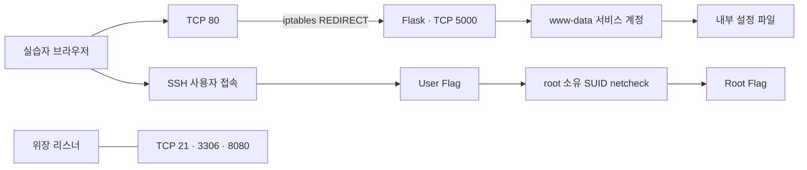

# KaliCTF

### 웹 취약점부터 Linux 권한 상승까지 연결한 CTF 가상머신 제작

웹 서비스의 작은 입력 처리 결함이 설정 파일 유출, SSH 계정 접근, 시스템 권한 상승으로 이어지는 과정을 학습할 수 있도록 제작한 보안 실습 환경입니다. 가상의 기업 포털 **Kali Corporation**을 진입점으로 구성하고, **SSTI → 자격 증명 노출 → SSH → SUID / PATH Hijacking**으로 이어지는 단계형 시나리오를 설계했습니다.

| 항목 | 내용 |
| --- | --- |
| 프로젝트 성격 | 개인 제작 보안 교육용 CTF VM |
| 제작자 | [문경구 · gyeonggumun](https://github.com/gyeonggumun) |
| 제작 범위 | CTF 환경 및 시나리오 전체 제작 |
| 실습 방식 | 제작한 환경을 바탕으로 5인 공동 보안 실습 진행 |
| 목표 | 웹 진입점 분석부터 User Flag, Root Flag 획득까지 연결 |
| 대상 환경 | Ubuntu 22.04.5 LTS / VirtualBox / 메모리 2GB |
| 공개 범위 | 포트폴리오 문서, VM에서 추출한 핵심 코드·설정, 정적 분석 근거 |

> 이 저장소는 의도적으로 취약하게 구성한 교육용 환경의 설계 기록입니다. 참고 코드와 설정은 격리된 실습 환경에서만 다룹니다.

## 제작 의도

개별 취약점의 성공 여부를 확인하는 데서 끝나지 않고, 다음 단계로 이어지는 단서를 해석하도록 구성했습니다. 웹 입력이 서버에서 어떻게 처리되는지, 서비스 계정이 어떤 파일을 읽을 수 있는지, 일반 사용자와 관리자 사이의 권한 경계가 어디에서 무너지는지를 하나의 흐름으로 경험하는 것이 목표입니다.

기업 포털의 일반 페이지에서 내부 매뉴얼로 이동하도록 탐색 경로를 구성하고, 매뉴얼에 `name` 파라미터와 서버 렌더링을 암시하는 힌트를 배치했습니다. 이후 설정 파일과 사용자 계정, 시스템 유틸리티를 연결해 웹과 Linux 보안을 함께 다루도록 설계했습니다.

## 내가 제작한 주요 구성

| 구성 | 구현 및 설계 내용 | 학습 포인트 |
| --- | --- | --- |
| 기업 포털 | Flask 기반 Home / About / Services 페이지 | 웹 구조와 숨겨진 탐색 경로 분석 |
| 단계형 힌트 | `/services` → `/support` → `/manual`로 이어지는 링크 | 정보 수집과 입력 지점 발견 |
| 취약한 진단 기능 | `name` 값을 템플릿 문자열에 삽입한 뒤 Jinja2로 렌더링 | SSTI와 입력·템플릿 경계 |
| 내부 설정 파일 | 웹 경로 아래 `.env`에 실습용 계정 정보 배치 | 파일 접근 권한과 비밀정보 관리 |
| 사용자 단계 | SSH 접속과 `user.txt` 확인 | 웹 접근에서 OS 계정 접근으로의 전환 |
| 권한 상승 단계 | root 소유 SUID `netcheck`와 PATH 기반 명령 탐색 | 실행 권한과 환경 변수 신뢰 문제 |
| 서비스 구성 | systemd 자동 재시작, HTTP 포트 리다이렉션 | 실습 서비스 운영과 네트워크 구성 |
| 위장 포트 | `ncat`으로 21 / 3306 / 8080 포트 리스너 구성 | 열린 포트만으로 서비스 종류를 단정하지 않기 |

## 환경 구조



웹 서비스는 `www-data` 계정으로 실행됩니다. 저장된 방화벽 규칙은 외부에서 들어오는 80번 포트를 5000번으로 전달하고, 5000번 포트로 직접 들어오는 패킷은 raw 테이블에서 차단하도록 구성되어 있습니다. 위장 포트는 실제 FTP·DB·HTTP 서비스를 구현한 것이 아니라 `ncat` 리스너입니다.

## 공격 시나리오와 확인 결과

| 단계 | 실습자가 확인하는 단서 | 다음 단계로 이어지는 결과 |
| --- | --- | --- |
| 1. 호스트 탐색 | 실습 대역의 가동 중인 호스트 | 웹 진입점 식별 |
| 2. 웹 탐색 | 내부 매뉴얼의 `name` 파라미터 안내 | 입력 처리 방식 조사 |
| 3. SSTI 확인 | `{{7*7}}` 입력 시 `49` 출력 | 서버 측 템플릿 평가 확인 |
| 4. 설정 파일 접근 | `/var/www/internal_api/.env` | 실습용 SSH 계정 정보 확인 |
| 5. 사용자 접근 | SSH 로그인 및 `user.txt` | User Flag 획득 |
| 6. 권한 분석 | `/usr/local/bin/netcheck`, root 소유, 권한 `4755` | SUID 프로그램 조사 |
| 7. PATH 조작 | 절대 경로 없이 탐색되는 `curl` | 사용자 제어 실행 파일로 연결 |
| 8. 최종 목표 | root 셸과 `/root/root.txt` | Root Flag 획득 |

User / Root Flag 획득 결과는 제공된 워크스루의 터미널 화면에서 확인했습니다. 이번 저장소 정리 과정에서는 VM을 부팅하거나 공격을 재실행하지 않았으며, 구현 근거는 가상 디스크를 읽기 전용으로 분석해 확인했습니다.

## 핵심 취약점 분석

### 1. 사용자 입력을 템플릿 코드로 해석하는 SSTI

[원본 웹 코드](reference/web/wsgi.py)는 요청의 `name` 값을 HTML 문자열에 먼저 삽입한 뒤, 완성된 문자열을 `render_template_string()`에 전달합니다.

```python
name = request.args.get('name')
content = f"""
<h2>Diagnostic Ping Mode</h2>
<p>Checking connectivity for node: <strong>{name}</strong></p>
"""
final_html = base_html.replace('__MAIN_CONTENT__', content)
return render_template_string(final_html)
```

이 구조에서는 입력에 포함된 템플릿 표현식이 단순한 출력 데이터가 아니라 서버에서 평가할 코드의 일부가 됩니다. 워크스루에서는 산술식 평가 이후 내부 설정 파일의 내용이 노출되는 흐름을 확인할 수 있습니다.

**개선 방향:** 고정된 템플릿에 값을 데이터로 전달하고, 사용자 입력을 템플릿 소스에 합치지 않습니다. 서비스 계정이 읽을 수 있는 비밀정보의 범위도 함께 제한해야 합니다.

### 2. 설정 파일 노출에서 SSH 접근으로 이어지는 계정 경계

원본 `.env`에는 `DB_USER`, `SSH_USER`, `SSH_PASS` 키가 존재합니다. 웹 기능에서 이 파일을 읽을 수 있으면 웹 취약점의 영향이 OS 계정 접근으로 확장됩니다. 원본 비밀번호는 공개하지 않고 [형식 예시](reference/web/.env.example)만 제공합니다.

**개선 방향:** 웹 프로세스와 로그인 계정의 비밀정보를 분리하고, 파일 소유권과 읽기 권한을 최소화합니다. 노출된 자격 증명은 폐기하고 교체해야 합니다.

### 3. SUID 프로그램이 PATH에 의존하는 명령을 호출

`netcheck`의 파일 메타데이터에서 **UID 0 / GID 0 / 권한 4755**를 확인했습니다. 바이너리의 동적 심볼과 문자열에는 `system`, `setuid`, `setgid`, `curl -I -s https://google.com`이 존재합니다. 워크스루에는 PATH 앞부분에 둔 가짜 `curl`을 통해 root 셸로 전환한 결과가 기록되어 있습니다.

**개선 방향:** 불필요한 SUID를 제거하고, 외부 명령을 실행해야 한다면 신뢰할 수 있는 절대 경로와 제한된 환경을 사용합니다. 셸 기반 실행을 피하고, 작업에 필요한 권한만 부여합니다.

## 제작을 통해 다룬 역량

- **공격 경로 설계:** 웹 입력, 파일 접근, 사용자 로그인, 관리자 권한을 단계별로 연결했습니다.
- **웹 취약점 구현:** Flask / Jinja2의 렌더링 과정에서 코드와 데이터의 경계가 무너지는 지점을 구성했습니다.
- **Linux 권한 모델 적용:** 서비스 계정, 일반 사용자, root 소유 SUID 파일의 권한 차이를 실습 요소로 사용했습니다.
- **실습 환경 구성:** systemd 서비스, 포트 리다이렉션, 위장 리스너를 조합했습니다.
- **결과 문서화:** User / Root 단계의 워크스루와 실제 코드·설정 근거를 연결했습니다.

## 저장소 안내

```text
KaliCTF/
├── README.md
├── docs/
│   ├── ANALYSIS.md                # 근거, 확인 범위, 개선 과제
│   └── evidence.json              # 추출 파일 SHA-256 및 netcheck 메타데이터
└── reference/
    ├── web/
    │   ├── wsgi.py                # VM에서 추출한 원본 Flask 코드
    │   └── .env.example           # 값이 제거된 설정 형식 예시
    ├── systemd/
    │   ├── ctf-web.service
    │   └── ctf-fake-ports.service
    └── network/
        └── rules.v4               # 원본 방화벽 규칙
```

`reference/`의 코드와 서비스·네트워크 설정은 분석용 발췌 자료입니다. 정적 이미지, 계정, 플래그, SUID 바이너리와 전체 VM이 포함되지 않아 이 저장소만으로 원본 CTF 전체를 복원할 수는 없습니다. 원본 VM의 네트워크는 브리지로 설정되어 있으므로, 별도 재현 시에는 격리된 내부 실습망으로 바꾸어 사용해야 합니다.

## 확인 범위와 후속 개선

이번 분석에서 웹 소스, systemd 서비스, 방화벽 규칙, 바이너리 권한과 문자열을 확인했습니다. 원본 `netcheck.c`는 확보하지 않았으며, 바이너리의 전체 제어 흐름이나 현재 서비스 가동 상태까지 검증한 것은 아닙니다.

후속 개선 과제는 비밀정보를 초기화하는 배포 절차, VM 자동 구축, User / Root 단계의 반복 재현 검증, 취약한 구현과 수정한 구현의 비교 실습입니다. 세부 근거는 [분석 기록](docs/ANALYSIS.md)에서 확인할 수 있습니다.
